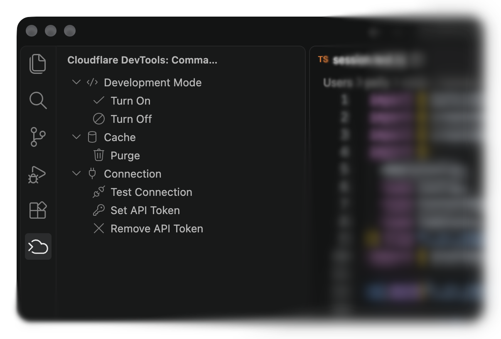
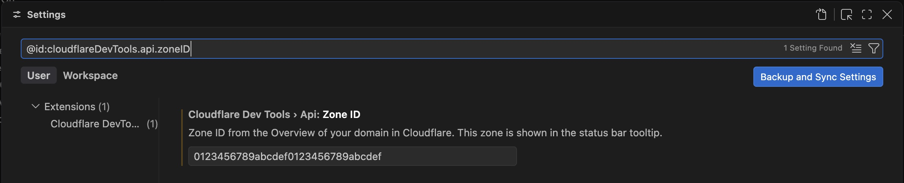
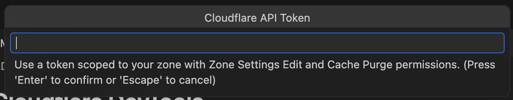
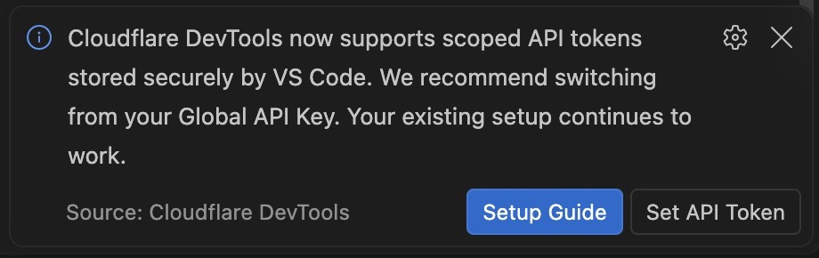
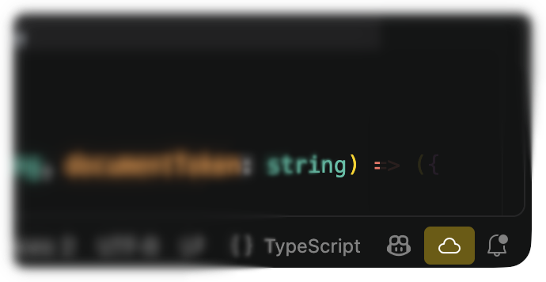

# Cloudflare DevTools

A [Visual Studio Code extension](https://marketplace.visualstudio.com/items?itemName=AlessandroBenassi.cloudflare-devtools) for managing Cloudflare's **Development Mode** and purging a zone's **cache**.

## Features

- Turn Development Mode on or off from the Command Palette, sidebar, or status bar.
- See the configured zone and Development Mode status, with optional background checks.
- Purge the zone's cache manually, or automatically three seconds after turning Development Mode on.
- Store a scoped API token in VS Code's encrypted secret storage.
- Test the connection without changing Cloudflare settings or purging content.



## Getting started

Requires VS Code 1.66 or later.

1. [Create a custom Cloudflare API token](https://developers.cloudflare.com/fundamentals/api/get-started/create-token/) with these permissions:
   - **Zone → Zone Settings → Edit** to read and change Development Mode. Cloudflare's API calls this permission **Zone Settings Write**; it also permits reading the setting.
   - **Zone → Cache Purge → Purge** to purge cached content.
2. Under **Zone Resources**, restrict the token to the specific zone you want to manage.
3. Copy the zone ID from the domain's Cloudflare overview and enter it in the **Cloudflare DevTools: API Zone ID** setting (`cloudflareDevTools.api.zoneID`).
4. Open the Command Palette and run **Cloudflare DevTools: Set API Token**. Paste the token into the password input.
5. Run **Cloudflare DevTools: Test Connection**. A successful check confirms that the extension can read Development Mode for the configured zone. It does not test permission to change settings or purge the cache.

**Zone ID setting**:



**Set API Token** opens a password input:



Permission references: [read a zone setting](https://developers.cloudflare.com/api/resources/zones/subresources/settings/methods/get/), [edit a zone setting](https://developers.cloudflare.com/api/resources/zones/subresources/settings/methods/edit/), and [purge cached content](https://developers.cloudflare.com/api/resources/cache/methods/purge/).

The token is stored using VS Code's encrypted secret storage. It is not written to `settings.json` and is not synced between machines. Run **Set API Token** again to replace it, or **Remove API Token** to delete the saved token.

### Existing Global API Key users

When a Global API Key is configured and no API token is saved, the extension shows a one-time informational notice with **Setup Guide** and **Set API Token** buttons. Dismissing it keeps your current setup working and stops the notice appearing again in that VS Code profile.



The existing `cloudflareDevTools.api.key` and `cloudflareDevTools.api.email` settings remain supported. A saved API token takes precedence over them. After testing your token, you can remove the old key and email from your settings. If a token connection succeeds while an old key is still configured, a one-time reminder offers **Open Settings** so you can remove the old key and email after testing. The extension never removes credentials automatically.

Removing a saved token makes the extension fall back to the key and email if they are still configured.

Cloudflare [recommends API tokens](https://developers.cloudflare.com/fundamentals/api/get-started/), which can be limited to the permissions and zone this extension needs.

## Using the extension

Open commands through the **Cloudflare DevTools** sidebar, the cloud icon in the status bar, or the Command Palette.

| Command | Action |
| --- | --- |
| Development Mode \| ON | Enable Development Mode for the configured zone. |
| Development Mode \| OFF | Disable Development Mode for the configured zone. |
| Purge Cache | Purge all cached content for the configured zone. |
| Set API Token | Save or replace the API token in encrypted secret storage. |
| Remove API Token | Delete the saved API token. |
| Test Connection | Read the zone's Development Mode status without changing it. |

The cloud icon in the status bar opens the extension’s commands. It is highlighted while Development Mode is on and shows a spinner while an action is running. Its tooltip identifies the configured zone and reports the current status. Development Mode expires automatically after three hours; the tooltip shows the remaining time when Cloudflare provides it.



Automatic cache purging runs only after successfully turning Development Mode **on**. Turning it off does not purge the cache. Changing the configuration cancels a pending automatic purge, so it cannot move to another zone.

Background status checks do not overlap. When requests fail, the extension waits longer before checking again and records the error without repeatedly showing notifications. User-triggered commands report failures directly.

## Extension settings

| Setting | Default | Purpose |
| --- | --- | --- |
| `cloudflareDevTools.api.zoneID` | Empty | The 32-character zone ID from Cloudflare. |
| `cloudflareDevTools.cache.purgeAutomatically` | `true` | Purge the cache three seconds after enabling Development Mode. |
| `cloudflareDevTools.developmentModeStatus.enable` | `true` | Check Development Mode in the background and update the status bar. |
| `cloudflareDevTools.developmentModeStatus.interval` | `60` | Seconds between normal status checks, from 5 to 86,400. Failures temporarily increase the delay. |
| `cloudflareDevTools.api.key` | Empty | Legacy Global API Key, used only when no API token is saved. |
| `cloudflareDevTools.api.email` | Empty | Account email for legacy Global API Key authentication. |

## Troubleshooting

- **Setup incomplete:** set the zone ID and save an API token, or complete the legacy key and email settings.
- **Authentication or permission error:** check that the token has not expired, includes the permissions above, and is allowed to access the configured zone.
- **Connection test succeeds but an action fails:** the connection test reads a setting; check the token's **Zone Settings Edit** or **Cache Purge** permission for the failing action.
- **Network or rate-limit error:** inspect the **Cloudflare DevTools** output log for details. Background checks wait longer after failures.

## Development

Use Node.js 24 for development and install the exact dependency versions from the lockfile:

```sh
npm ci
npm test
npm run test:integration
npm run package
```

`npm test` runs lint and unit tests with mocked requests. Integration tests build and extract the `.vsix`, then download and launch VS Code with an isolated profile to exercise the packaged extension's activation and command registration without Cloudflare credentials. Set `VSCODE_VERSION` to `1.66.0` or `stable` to select the VS Code version.

`npm run package` builds and inspects `dist/cloudflare-devtools-1.1.0.vsix`. CI checks the supported VS Code baseline and the current release, audits dependencies, and validates the package. Packaging does not publish a release. Dependabot checks npm packages and GitHub Actions weekly, grouping compatible minor and patch updates.

The packaging tool `@vscode/vsce` is pinned to 3.9.2 because the published 4.0.0 package was missing its runtime files when checked. A scoped `@azure/msal-node` override updates a dependency affected by [GHSA-xcx6-jx8p-x3h5](https://github.com/advisories/GHSA-xcx6-jx8p-x3h5). Review these temporary constraints when updating the packaging tool.

## Links and feedback

- [VS Code Marketplace](https://marketplace.visualstudio.com/items?itemName=AlessandroBenassi.cloudflare-devtools)
- [GitHub repository](https://github.com/solid-pixel/vscode-cloudflareDevTools)
- [Changelog](CHANGELOG.md)
- [Report an issue](https://github.com/solid-pixel/vscode-cloudflareDevTools/issues/new)
- [Cloudflare API](https://developers.cloudflare.com/api/)
- [LinkedIn](https://www.linkedin.com/in/ap-benassi/)

## I love Pizza 🍕

[](https://ko-fi.com/N4N7BY7DX)
